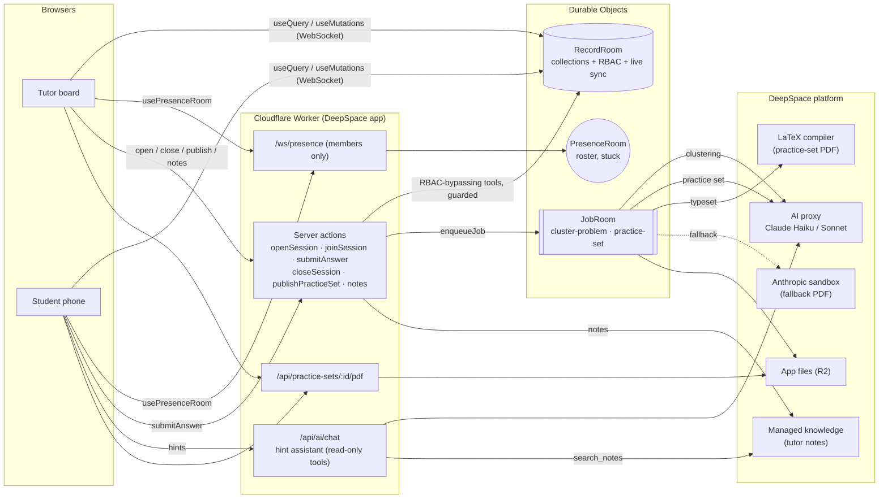

# TutorPulse

**A live room for group tutoring that shows the tutor _why_ students get a problem wrong, while the session is still running.**

Students join with a 6-character code or QR code and submit an answer, with their working on a sketch pad (or, without it, an optional line on how they got it). Answers are checked **deterministically** with mathjs. The wrong ones are grouped by Claude into named **misconception clusters** ("Dropped the inner derivative — 7") that update live on the tutor's board. The tutor puts a cluster on every student's screen, explains it, re-opens answers and watches the count fall. When the session ends, the app writes a **practice-set PDF**, typeset with LaTeX, that targets the group's actual mistakes, with every derivative answer worked out by computer algebra. Students also get a read-only, Socratic **hint assistant** grounded in the tutor's uploaded notes.

> students submit → AI groups the wrong answers by *why* → tutor teaches to the biggest group → students revise → everyone leaves with targeted practice

- **Live:** https://tutorpulse.app.space · **Demo video (2 min, with the whiteboard):** [docs/demo/tutorpulse-demo.mp4](docs/demo/tutorpulse-demo.mp4)
- **Spec:** [docs/REQUIREMENTS.md](docs/REQUIREMENTS.md) · **SDK findings:** [docs/SDK_NOTES.md](docs/SDK_NOTES.md) · **Build log:** [docs/AGENT_LOG.md](docs/AGENT_LOG.md)

---

## Architecture



**Why it's shaped this way**
- **AI never grades.** `src/lib/answerCheck.ts` compares answers numerically at 5 sample points (1e-6 tolerance), parsing student text against an allowlist. Only *wrong* answers go to the AI, which keeps the counts trustworthy and the cost low.
- **Privacy is enforced in the data layer, not the UI.** Every collection has row-level rules. `submissions`, `clusters` and `followUps` can only be written by server code. The answer key has its own tutor-only collection, because DeepSpace can't hide a single field.
- **Server code is the trust boundary.** Actions and jobs bypass RBAC, so every action starts with `requireTutor` / `requireParticipant` (`src/actions/guards.ts`) and scopes every query to what that guard returned.
- **Clustering is debounced:** at most one job per problem is in flight, and new answers mark it "dirty" so it runs once more. Output is validated with zod (each wrong answer exactly once, labels ≤ 6 words), retried once with the reason, and falls back to grouping identical answers.

### Code map

| Path | What's there |
| --- | --- |
| `src/schemas/` | 9 app collections (incl. `followUps`) + permissions (`permissions.ts` holds the shared deny/admin baselines) |
| `src/actions/` | Server actions, `guards.ts`, the debounced clustering trigger, test-only fixtures |
| `src/jobs.ts`, `src/jobs/` | Background jobs: `cluster-problem`, `practice-set` |
| `src/ai/prompts/` | The four prompts (clustering, hints, practice set, follow-up check), kept separate so they're easy to read and tune |
| `src/ai/tools.ts`, `src/ai/chat-routes.ts` | Hint assistant tools and chat route (session gate, cap, owner billing) |
| `src/lib/` | Pure logic with unit tests: answer checking, cluster validation, history, working images, join codes, limits |
| `src/server/` | Worker routes: actions, members-only presence, practice-set download, owner record helpers |
| `src/components/session/`, `src/pages/` | Tutor setup/board, student view, sketch pad, roster, notes, hints, practice set, QR, history |
| `tests/` | Playwright E2E (multi-user) + specs that run against the live app |

---

## DeepSpace features

**Used**

| Feature | What it does here | Where |
| --- | --- | --- |
| Auth | Identifies tutors and students; every action reads the verified `userId` | scaffold, `src/actions` |
| Collections + `useQuery` / `useMutations` | Sessions, problems, answer keys, submissions, clusters, practice sets, notes | `src/schemas`, pages |
| Real-time sync (RecordRoom) | The board, clusters, focus banner and practice-set status update live with no polling | every `useQuery` |
| Row-level permissions (`own`, `collaborator`, `ownerField`, `collaboratorsField`, `uniqueOn`, `writableFields`) | Students see only their own work; only the tutor sees all answers, clusters and the key | `src/schemas` |
| Server actions | Join with a code, submit + check, open/close, publish, notes | `src/actions` |
| Presence (`usePresenceRoom`) | Live roster: online, current problem, submitted, "I'm stuck" | `TutorRoster`, `StudentView` |
| Background jobs (`enqueueJob`, `ctx.progress`, chaining) | Clustering and practice-set generation | `src/jobs` |
| File storage (`useR2Files`, `appFiles`) | Tutor notes uploads; practice-set PDFs in the tutor's private folder | `NotesPanel`, `practice-set` job |
| **AI generation via the DeepSpace proxy** | Misconception clustering (`createDeepSpaceAI` + `generateText` + structured output) | `src/jobs/cluster-problem.ts` |
| **AI chat + custom tools** (`ChatPanel`, `registerAgent`) | Read-only Socratic hint assistant with `get_current_problem` / `search_notes` | `src/ai` |
| **LaTeX compiler integration** (`latex-compiler/compile` via `buildCronContext().integrations.call`) | Typesets the practice-set PDF. Claude writes the problems as structured data; mathjs writes each derivative question and works out (or checks) its answer; the server builds the `.tex` itself, with a pgfplots chart of the exact correct rates, escaped text and an allowlist of maths commands, so AI output can't run `\input` or `\write` | `src/jobs/practice-set.ts`, `src/lib/practiceLatex.ts` |
| **Anthropic sandbox** (`codeExecutionTool`, `sandboxFiles`) | Fallback: if the LaTeX path fails, Python in the sandbox writes the PDF instead | `src/jobs/practice-set.ts` |
| **Email integration** (`email/send` via `ctx.tools.integration`) | Opt-in recap emails after a session: each student who ticked the box gets only their own results | `src/actions/recap-actions.ts`, `src/lib/recapEmail.ts` |
| **Managed knowledge** (`knowledge(env).scoped`) | Hints grounded in the tutor's own notes, one folder per session | `src/actions/notes-actions.ts`, `src/ai/tools.ts` |
| **Local agent tools** (`registerAgent`) | `npx deepspace agent invoke tutorpulse sessionReport` gives the tutor's own coding agent a session report (tutor-only, counts and labels only) | `src/ai/tools.ts`, `src/lib/sessionReport.ts` |
| Multi-user testing (`users` fixture) | Tutor + 2 students in one Playwright test | `tests/` |
| Deploy | One command to `tutorpulse.app.space` | `npx deepspace deploy` |

**Deliberately left out**

| Not used | Why |
| --- | --- |
| LiveKit audio/video | Group tutoring is in a room or already on Zoom; video adds cost and failure points without helping the core moment. |
| Payments | Peer and university tutoring is free; nothing in a session needs billing. |
| Collaborative text (Yjs) | Students answer individually by design; a shared editor would mix answers and break clustering. |
| Messaging channels | The tutor is in the room; "I'm stuck" as presence is lighter and leaves no stale messages. |
| Google OAuth / Calendar | Built-in sign-in is enough for a live tool. |
| Scheduled jobs | Nothing recurs yet (a weekly misconception digest is a natural next step). |
| Mobile app publishing | The student view is responsive web opened from a QR code. |

---

## Run, test, deploy

Requirements: **Node 22.15+ (not 23)** and **npm ≥ 11.6** (npm 10's resolver crashes on this dependency tree).

```bash
npm install
npx deepspace auth login          # once
npx deepspace dev start           # local dev server (Vite + Workers runtime)
```

**Tests**

```bash
npm run test:unit                 # ~150 Vitest tests: answer checking (T6), cluster validation (T7), guards, schemas
npx deepspace test run all        # Playwright, local: T1–T5, T8 (working privacy), walkthrough, phone layout
RUN_AI_TESTS=1 npx deepspace test run tests/whiteboard.spec.ts   # pad → tutor thumbnail, one small AI call
RUN_AI_TESTS=1 npx deepspace test run tests/follow-up.spec.ts    # follow-up check, two small AI calls
RUN_AI_TESTS=1 npx deepspace test run tests/work-photo.spec.ts   # photo of paper working, one small AI call
RUN_AI_EVAL=1 EVAL_SET=working [EVAL_NO_IMAGES=1] npx deepspace test run tests/clustering-eval.spec.ts
```

The multi-user specs need test accounts. The first one created is used as the tutor:

```bash
printf %s "$PW" | npx deepspace test accounts create --email tutor-<suffix>@deepspace.test --name "Tutor" --password-stdin
```

Test-account emails are global across all DeepSpace developers, so add a unique suffix. Credentials are stored only in `~/.deepspace/test-accounts.json`.

| Spec | Covers |
| --- | --- |
| `tests/privacy.spec.ts` | **T4** — students can't read others' submissions, the answer key, clusters or unpublished practice sets, and can't forge writes (real data-layer denials, with the tutor as a positive control) |
| `tests/actions.spec.ts` | **T5** — forged / out-of-turn requests: non-participant, locked problem, tutor-only actions, presence room and PDF route for strangers |
| `tests/core-loop.spec.ts` | **T1–T3** + live clustering |
| `tests/walkthrough.spec.ts` | Revise → cluster shrinks, lock / re-open, switch problem, end session |
| `tests/mobile.spec.ts` | Every main screen at 390 px with no horizontal overflow |
| `tests/phase3.spec.ts` | Roster + stuck, drill-in, take to board, notes, hints (T9), practice-set PDF (T10). **AI-billed:** `RUN_AI_TESTS=1` |
| `tests/clustering-eval.spec.ts` | Prints real clustering output for the 3 demo problems. **AI-billed:** `RUN_AI_EVAL=1` |
| `tests/work-privacy.spec.ts` | **T8**: working images reach only the student and their tutor; borrowed keys and non-images refused |
| `tests/follow-up.spec.ts` | Follow-up check reaches only the misconception group; others can't see or answer it. **AI-billed** |
| `tests/work-photo.spec.ts` | Photo working: EXIF (incl. GPS) stripped on the phone, a raw EXIF photo refused, the AI reads it |
| `tests/answer-kinds.spec.ts` | Number lists, intervals, DNE and an expression in t, marked correct through `submitAnswer` |
| `tests/history.spec.ts` | Tutor history across sessions; a student gets none of it; no emails in the response |
| `tests/workpad.spec.ts` | Sketch pad: no text selection while drawing; zoom in, zoom out for more room, Move; two-finger drag moves without zooming; full screen fills the screen (laptop, phone upright and sideways) and covers the page; palm rejection after a stylus stroke |
| `tests/recap-email.spec.ts` | Recap opt-in is off by default; only the session's tutor can send, once the session has ended; nobody reads or forges another student's opt-in; each student is emailed at most once (test accounts are never really emailed) |
| `tests/practice-set.spec.ts` | Practice set alone: PDF typeset by LaTeX (pdfTeX producer), shared, downloaded by a student. **AI-billed** |

Run any spec against the deployed app with `npx playwright test -c tests/playwright.live.config.ts tests/<spec>`. The test-only seed actions used by T4 and the eval exist only when `ALLOW_DEBUG_ROUTES=true` (local), and only for `@deepspace.test` accounts.

**Deploy**

```bash
git commit -am "…" && npx deepspace deploy
node scripts/seed-demo.ts         # dev-only: creates the demo session for the CLI's logged-in account
```

No API keys live in this repo. AI, the LaTeX compiler, email, the sandbox and knowledge all go through the DeepSpace platform, billed to the app owner with per-session caps (`src/lib/limits.ts`: 30 clustering runs, 5 practice sets, 200 hint turns, 15 follow-up drafts, recap emails at most once per student per session). `.dev.vars` is generated and git-ignored.

---

**Session report for your coding agent (F17):**

```bash
npx deepspace agent invoke tutorpulse sessionReport          # your most recent session
```

## Demo (2–3 browsers)

1. **Tutor:** sign in at `/home` and open **Calc I — Chain Rule Review** (created by `scripts/seed-demo.ts`), or create a session and add problems (prompt in LaTeX, answer as an expression in x). Optionally upload notes. Click **Open session**.
2. **Students:** scan the QR code or enter the code at `/home`, sign in, and answer. Try `cos(3x^2)` with "derivative of sin is cos" for a wrong answer, and `6x cos(3x²)` for a right one.
3. **Board:** watch the counts and the named cluster appear within seconds. Click **Show answers**, then **Take to board**; students see "Discussing: …". Students tap **I'm stuck** or **Hint**.
4. **Revise:** **Re-open answers**; a student fixes their answer and the cluster count falls.
5. **Wrap up:** **End session** → **Generate practice set** (about a minute) → **Download to review** → **Share with students** → students download the PDF → **Email recaps** to students who ticked "Email me a recap". (Generation is a deliberate click rather than automatic, so AI credits are only spent when the tutor wants a set.)

## Whiteboard: grouping by the working, not just the answer

Students can write their steps on a sketch pad under each problem (finger, stylus or mouse; pen, eraser, undo, clear). The typed final answer still decides right or wrong, so counts stay exact. The drawing only changes *why* a wrong answer is grouped where it is:

- **Storage and privacy.** The pad exports an 800 px PNG into the student's **private** folder (`useR2Files`, scope `self`, one key per problem, so revisions replace it). `submitAnswer` re-reads that key from the caller's own folder and checks it is a small PNG before storing `submissions.workKey`, so a student can't attach anyone else's file. The image leaves the folder only through `GET /api/submissions/:id/work`, which answers the student who wrote it and the session's tutor (404 for everyone else). Covered by `tests/work-privacy.spec.ts` (T8).
- **Clustering.** The job attaches up to 12 working images (newest first) labelled with their submission ids, and the prompt tells Claude to group by the first step where the working goes wrong.
- **Tutor view.** Each group's "Show answers" includes the working as a thumbnail; tap to enlarge.
- **Comfort.** The page starts 4:3 and **grows downwards**: zooming out (to 50%) shows more paper, writing near the bottom adds room, and **More space** adds it on demand (up to 3 pages tall; only the part with ink is saved). Zoom with + and −, a pinch or ctrl/⌘ + scroll (up to 400%); move with two fingers, scroll or the Move tool. Two fingers only zoom once they clearly spread or pinch, so a two-finger drag is a clean move. **Full screen** gives the pad every pixel under the question and toolbar (upright or sideways phone, laptop), so nothing else can be touched while writing. A stroke never starts a text selection anywhere on the page, and once a stylus is used, finger and palm touches only move the page (palm rejection). Tutor thumbnails show the top of the working; tap to see it all. `tests/workpad.spec.ts`.
- **Photos of paper.** Most students work on paper, so "Use a photo of paper instead" takes a picture. The phone shrinks it and re-encodes it as JPEG, which drops the EXIF block (camera details and **GPS location**). The server accepts only a PNG drawing or an EXIF-free JPEG, so a raw phone photo uploaded some other way is refused rather than passing a location on to the tutor (`tests/work-photo.spec.ts`).
- **Does it help?** On a set built the way real rooms look (vague notes; one wrong answer, 7/(x−3)², reached by two different mistakes), agreement with the intended groups was **0.92 without the images and 1.00 with them** (`docs/clustering-eval/5-…`, `6-…`; one run each, so treat it as a sign, not a benchmark). The eval images are typed text in a handwriting font (`docs/clustering-eval/sample-working.png`), not real handwriting.
- **Real handwriting.** In a live trial (`docs/HANDWRITING_TRIAL.md`), two students gave the same wrong answer, 7/(x−3)², and no typed reason: one wrote the working with a finger on the phone pad (quotient-rule terms swapped), the other photographed paper (dropped the minus because the bottom is squared). The board split them into **two correct groups**, "Swapped the quotient rule order" and "Thinks squaring makes it positive", each explanation quoting a step that appears only in that student's working (`docs/clustering-eval/7-real-handwriting.txt`, screenshot alongside). One run, one writer who knew the mistakes, so a good sign rather than proof.

## Follow-up checks, answer kinds, recap emails, history

- **"Check it landed."** Students re-answering the same problem right after the explanation is weak evidence. From any misconception group, the tutor can have the AI draft one fresh problem aimed at the same mistake, review it, and send it to that group only. For derivative questions the AI only suggests the function; mathjs writes the prompt and differentiates it for the key, so the key is exact ("worked out by maths"); anything else is marked for the tutor to check. It becomes a normal tutor-owned problem plus one server-written `followUps` row per student, readable by that student and the tutor only, so nobody learns who else was in the group; `submitAnswer` refuses it from anyone else. The board shows "2 of 3 now get it right".
- **More kinds of answers.** The key's form picks the comparison: expressions in x, t or θ; numbers (`x = -1, 3`, any order, `±2`); intervals (`(-inf, 2) U (3, inf)` or `x < 2 or x > 3`); limits (`DNE`, `inf`). Writing this found and fixed an allowlist gap: names used as function arguments (`sin(y)`) skipped the check.
- **Recap emails (opt-in).** A student can tick "Email me a recap of this session" (off by default, per session). After the session ends, the tutor clicks **Email N recaps** and each of those students gets one email through the DeepSpace `email/send` integration with **only their own results**: right or not for each problem, their own answer, the name of their mistake group, and a link back (pointing to the practice set if it's shared). Never the answer key, other students, or the AI's explanation (written for the tutor, and it may quote others' answers). Addresses are read on the server and never stored, logged or returned; the tutor only sees counts. `sentAt` stops anyone being emailed twice, and `@deepspace.test` accounts are marked but never emailed, so tests send no real mail. The opt-in lives in `recapRequests`, which only server actions write.
- **History** (`/history`, linked from home). Each student's correct rate session by session and the misconceptions that came back across sessions, plus a summary of every session. It names students, so it is a tutor-only page, never the projected board; `tutorHistory` reads only sessions the caller ran and returns display names only.

## Known limitations / next steps

- Answers are checked automatically when they're an expression (in x, t or θ), a list of numbers, intervals, or DNE/∞. Anything else (points, words, multi-variable answers) is "needs review" and goes to clustering as raw text.
- Clustering tends to be fine-grained with few answers. The prompt (`src/ai/prompts/cluster.ts`) is the place to tune it.
- Joining is a read-modify-write on a JSON list, retried until the student is present. A burst of simultaneous joins is very unlikely to lose one, but it isn't impossible.
- If tutor notes contain worked solutions, the hint assistant could quote them (the upload panel warns).
- `problems` are readable by every signed-in user (prompts aren't secret); private problem banks would need a per-session room.
- Real handwriting has been tried once (two students, one writer; see the whiteboard section); rushed, messy writing from a full room is still untested. Only the newest 12 images per run are sent to the AI. A follow-up check whose key isn't a derivative relies on the tutor reviewing the AI's key.
- Next: a weekly misconception digest, LMS export, and history trends per topic rather than per session.
