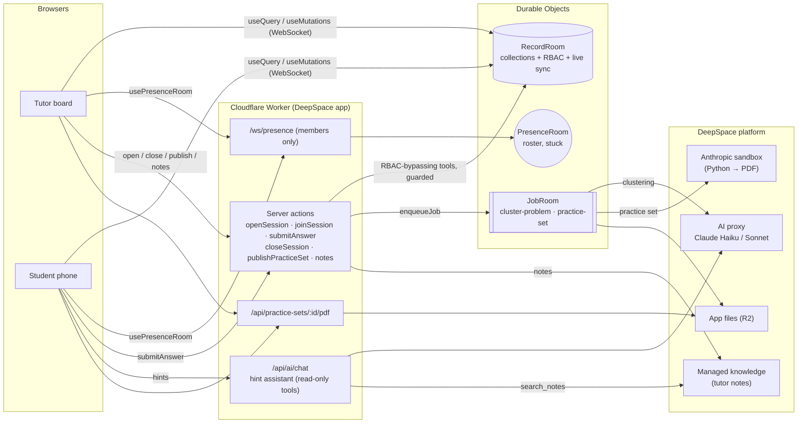

# TutorPulse

**A live room for group tutoring that shows the tutor _why_ students get a problem wrong, while the session is still running.**

Students join with a 6-character code or QR code and submit an answer plus one line on how they got it. Answers are checked **deterministically** with mathjs. The wrong ones are grouped by Claude into named **misconception clusters** ("Dropped the inner derivative — 7") that update live on the tutor's board. The tutor puts a cluster on every student's screen, explains it, re-opens answers and watches the count fall. When the session ends, the app writes a **practice-set PDF** in Anthropic's sandbox that targets the group's actual mistakes. Students also get a read-only, Socratic **hint assistant** grounded in the tutor's uploaded notes.

> students submit → AI groups the wrong answers by *why* → tutor teaches to the biggest group → students revise → everyone leaves with targeted practice

- **Live:** https://tutorpulse.app.space
- **Spec:** [docs/REQUIREMENTS.md](docs/REQUIREMENTS.md) · **SDK findings:** [docs/SDK_NOTES.md](docs/SDK_NOTES.md) · **Build log:** [docs/AGENT_LOG.md](docs/AGENT_LOG.md)

---

## Architecture



**Why it's shaped this way**
- **AI never grades.** `src/lib/answerCheck.ts` compares answers numerically at 5 sample points (1e-6 tolerance), parsing student text against an allowlist. Only *wrong* answers go to the AI, which keeps the counts trustworthy and the cost low.
- **Privacy is enforced in the data layer, not the UI.** Every collection has row-level rules. `submissions` and `clusters` can only be written by server code. The answer key has its own tutor-only collection, because DeepSpace can't hide a single field.
- **Server code is the trust boundary.** Actions and jobs bypass RBAC, so every action starts with `requireTutor` / `requireParticipant` (`src/actions/guards.ts`) and scopes every query to what that guard returned.
- **Clustering is debounced:** at most one job per problem is in flight, and new answers mark it "dirty" so it runs once more. Output is validated with zod (each wrong answer exactly once, labels ≤ 6 words), retried once with the reason, and falls back to grouping identical answers.

### Code map

| Path | What's there |
| --- | --- |
| `src/schemas/` | 8 app collections + permissions (`permissions.ts` holds the shared deny/admin baselines) |
| `src/actions/` | Server actions, `guards.ts`, the debounced clustering trigger, test-only fixtures |
| `src/jobs.ts`, `src/jobs/` | Background jobs: `cluster-problem`, `practice-set` |
| `src/ai/prompts/` | The three prompts (clustering, hints, practice set), kept separate so they're easy to read and tune |
| `src/ai/tools.ts`, `src/ai/chat-routes.ts` | Hint assistant tools and chat route (session gate, cap, owner billing) |
| `src/lib/` | Pure logic with unit tests: answer checking, cluster validation, join codes, limits |
| `src/server/` | Worker routes: actions, members-only presence, practice-set download, owner record helpers |
| `src/components/session/`, `src/pages/` | Tutor setup/board, student view, roster, notes, hints, practice set, QR |
| `tests/` | Playwright E2E (multi-user) + specs that run against the live app |

---

## DeepSpace features

**Used**

| Feature | What it does here | Where |
| --- | --- | --- |
| Auth | Identifies tutors and students; every action reads the verified `userId` | scaffold, `src/actions` |
| Collections + `useQuery` / `useMutations` | Sessions, problems, answer keys, submissions, clusters, practice sets, notes | `src/schemas`, pages |
| Real-time sync (RecordRoom) | The board, clusters, focus banner and practice-set status update live with no polling | every `useQuery` |
| Row-level permissions (`own`, `collaborator`, `ownerField`, `collaboratorsField`, `uniqueOn`, `writableFields`) | Students see only their own work; only the tutor sees all answers, clusters and the key | `src/schemas` |
| Server actions | Join with a code, submit + check, open/close, publish, notes | `src/actions` |
| Presence (`usePresenceRoom`) | Live roster: online, current problem, submitted, "I'm stuck" | `TutorRoster`, `StudentView` |
| Background jobs (`enqueueJob`, `ctx.progress`, chaining) | Clustering and practice-set generation | `src/jobs` |
| File storage (`useR2Files`, `appFiles`) | Tutor notes uploads; practice-set PDFs in the tutor's private folder | `NotesPanel`, `practice-set` job |
| **AI generation via the DeepSpace proxy** | Misconception clustering (`createDeepSpaceAI` + `generateText` + structured output) | `src/jobs/cluster-problem.ts` |
| **AI chat + custom tools** (`ChatPanel`, `registerAgent`) | Read-only Socratic hint assistant with `get_current_problem` / `search_notes` | `src/ai` |
| **Anthropic sandbox** (`codeExecutionTool`, `sandboxFiles`) | Python writes the practice-set PDF and correct-rate chart | `src/jobs/practice-set.ts` |
| **Managed knowledge** (`knowledge(env).scoped`) | Hints grounded in the tutor's own notes, one folder per session | `src/actions/notes-actions.ts`, `src/ai/tools.ts` |
| **Local agent tools** (`registerAgent`) | `npx deepspace agent invoke tutorpulse sessionReport` gives the tutor's own coding agent a session report (tutor-only, counts and labels only) | `src/ai/tools.ts`, `src/lib/sessionReport.ts` |
| Multi-user testing (`users` fixture) | Tutor + 2 students in one Playwright test | `tests/` |
| Deploy | One command to `tutorpulse.app.space` | `npx deepspace deploy` |

**Deliberately left out**

| Not used | Why |
| --- | --- |
| LiveKit audio/video | Group tutoring is in a room or already on Zoom; video adds cost and failure points without helping the core moment. |
| Payments | Peer and university tutoring is free; nothing in a session needs billing. |
| Collaborative text (Yjs) | Students answer individually by design; a shared editor would mix answers and break clustering. |
| Messaging channels | The tutor is in the room; "I'm stuck" as presence is lighter and leaves no stale messages. |
| Google OAuth / Calendar | Built-in sign-in is enough for a live tool. |
| Scheduled jobs | Nothing recurs yet (a weekly misconception digest is a natural next step). |
| Mobile app publishing | The student view is responsive web opened from a QR code. |

---

## Run, test, deploy

Requirements: **Node 22.15+ (not 23)** and **npm ≥ 11.6** (npm 10's resolver crashes on this dependency tree).

```bash
npm install
npx deepspace auth login          # once
npx deepspace dev start           # local dev server (Vite + Workers runtime)
```

**Tests**

```bash
npm run test:unit                 # 100+ Vitest tests: answer checking (T6), cluster validation (T7), guards, schemas
npx deepspace test run all        # Playwright, local: T1–T5, walkthrough, phone layout
```

The multi-user specs need test accounts. The first one created is used as the tutor:

```bash
printf %s "$PW" | npx deepspace test accounts create --email tutor-<suffix>@deepspace.test --name "Tutor" --password-stdin
```

Test-account emails are global across all DeepSpace developers, so add a unique suffix. Credentials are stored only in `~/.deepspace/test-accounts.json`.

| Spec | Covers |
| --- | --- |
| `tests/privacy.spec.ts` | **T4** — students can't read others' submissions, the answer key, clusters or unpublished practice sets, and can't forge writes (real data-layer denials, with the tutor as a positive control) |
| `tests/actions.spec.ts` | **T5** — forged / out-of-turn requests: non-participant, locked problem, tutor-only actions, presence room and PDF route for strangers |
| `tests/core-loop.spec.ts` | **T1–T3** + live clustering |
| `tests/walkthrough.spec.ts` | Revise → cluster shrinks, lock / re-open, switch problem, end session |
| `tests/mobile.spec.ts` | Every main screen at 390 px with no horizontal overflow |
| `tests/phase3.spec.ts` | Roster + stuck, drill-in, take to board, notes, hints (T9), practice-set PDF (T10). **AI-billed:** `RUN_AI_TESTS=1` |
| `tests/clustering-eval.spec.ts` | Prints real clustering output for the 3 demo problems. **AI-billed:** `RUN_AI_EVAL=1` |

Run any spec against the deployed app with `npx playwright test -c tests/playwright.live.config.ts tests/<spec>`. The test-only seed actions used by T4 and the eval exist only when `ALLOW_DEBUG_ROUTES=true` (local), and only for `@deepspace.test` accounts.

**Deploy**

```bash
git commit -am "…" && npx deepspace deploy
node scripts/seed-demo.ts         # dev-only: creates the demo session for the CLI's logged-in account
```

No API keys live in this repo. AI, the sandbox and knowledge all go through the DeepSpace platform, billed to the app owner with per-session caps (`src/lib/limits.ts`: 30 clustering runs, 5 practice sets, 200 hint turns). `.dev.vars` is generated and git-ignored.

---

**Session report for your coding agent (F17):**

```bash
npx deepspace agent invoke tutorpulse sessionReport          # your most recent session
```

## Demo (2–3 browsers)

1. **Tutor:** sign in at `/home` and open **Calc I — Chain Rule Review** (created by `scripts/seed-demo.ts`), or create a session and add problems (prompt in LaTeX, answer as an expression in x). Optionally upload notes. Click **Open session**.
2. **Students:** scan the QR code or enter the code at `/home`, sign in, and answer. Try `cos(3x^2)` with "derivative of sin is cos" for a wrong answer, and `6x cos(3x²)` for a right one.
3. **Board:** watch the counts and the named cluster appear within seconds. Click **Show answers**, then **Take to board**; students see "Discussing: …". Students tap **I'm stuck** or **Hint**.
4. **Revise:** **Re-open answers**; a student fixes their answer and the cluster count falls.
5. **Wrap up:** **End session** → **Generate practice set** (about a minute) → **Download to review** → **Share with students** → students download the PDF. (Generation is a deliberate click rather than automatic, so AI credits are only spent when the tutor wants a set.)

## Known limitations / next steps

- Answers are checked only when they're expressions in **x**; anything else is "needs review" and goes to clustering as raw text.
- Clustering tends to be fine-grained with few answers. The prompt (`src/ai/prompts/cluster.ts`) is the place to tune it.
- Joining is a read-modify-write on a JSON list, retried until the student is present. A burst of simultaneous joins is very unlikely to lose one, but it isn't impossible.
- If tutor notes contain worked solutions, the hint assistant could quote them (the upload panel warns).
- `problems` are readable by every signed-in user (prompts aren't secret); private problem banks would need a per-session room.
- Next: session history and per-student trends, handwriting/photo answers, a weekly misconception digest, LMS export.
